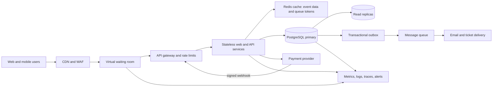

# TicketHub: Ticketing System Design

## 1. Requirements

### Functional requirements

- Visitors can browse and search published concerts and events, and view event details, venue information, prices, and a seat map.
- Users can register or sign in, select one or more available seats, and place a temporary hold while they check out.
- Users can pay for an order, receive a confirmation, and view or retrieve their tickets.
- Organizers can create events, configure seat inventory and prices, and publish an event at a scheduled on-sale time.
- The system releases unpaid holds after their expiration and sends order and ticket updates.

### Non-functional requirements

- **Speed:** Cached event pages should respond within 300 ms at p95 under normal load. Seat availability and hold results should respond within 1 second at p95 during a sale, excluding third-party payment time.
- **Correctness:** A seat can have at most one active hold or one completed sale. Order totals and ticket ownership must be consistent with the final payment result. Payment requests and callbacks must be idempotent.
- **Fairness:** At a scheduled on-sale time, eligible waiting users enter a randomized queue; later arrivals join in arrival order. A signed queue token, per-account limits, and rate limiting prevent queue skipping and excessive concurrent holds. Queue admission is paced to protect checkout and inventory services.
- **Availability:** Target 99.9% monthly availability for browsing and checkout APIs. During a sale, a controlled queue is preferable to accepting traffic that makes checkout unreliable.
- **Scalability:** Stateless web and API services scale horizontally. Read traffic is cached and separated from transactional seat writes. The waiting room can represent all 200,000 visitors without sending all of them to the inventory database.
- **Security and privacy:** Require authenticated checkout, encrypt traffic and stored personal data, minimize payment data by using a payment provider's tokenized checkout, and audit administrative changes.

## 2. Traffic Estimates

### Normal day

Given 50,000 daily visitors, each viewing 10 pages:

- Page views: `50,000 x 10 = 500,000 requests/day`.
- Average page-request rate across 24 hours: `500,000 / 86,400 = 5.8 requests/second`.
- Planning peak: assume a 10x peak-to-average ratio, or about **58 page requests/second**. This is an explicit sizing assumption; production metrics should replace it.
- Ticket sales: 5,000 tickets/day, or `5,000 / 86,400 = 0.058 sales/second` on a 24-hour average. If concentrated in a 10-hour active period, the average is about 0.14 sales/second.

### Popular concert sale

200,000 people try to buy 20,000 seats in the first 10 minutes:

- Arrival/attempt rate: `200,000 / 600 = 333 users/second` on average.
- Seat demand is **10 times inventory**. At most 20,000 users can receive a seat; 180,000 will not.
- Assuming two read requests per user (event/seat-map views): `400,000 / 600 = 667 read requests/second` on average.
- Assuming one hold attempt per user: another **333 transactional requests/second** on average.
- Combined sale-flow average is about **1,000 requests/second**. Plan for short bursts around 3x that rate, or roughly **3,000 requests/second**, while load testing the database and queue.
- If all 20,000 seats are sold within the same 10 minutes, successful checkouts average at most `20,000 / 600 = 33 per second`; payment attempts can be burstier and are paced separately.

| Measure               |                          Normal planning load |                                Popular sale |                                    Approximate comparison |
| --------------------- | --------------------------------------------: | ------------------------------------------: | --------------------------------------------------------: |
| Read/page requests    |                 58 requests/s peak assumption | 667 requests/s average; 2,000/s at 3x burst | 11x average sale vs normal peak; 34x burst vs normal peak |
| Hold/booking attempts | About 0.14 sales/s in a 10-hour active period |                      333 attempts/s average |             About 2,400x the active-period normal average |
| Incoming users        |                                    50,000/day |                       200,000 in 10 minutes |      4x a full normal day's visitors in 1/144 of the time |

These rates are estimates, not guarantees. A waiting room buffers the 200,000 arrivals; it does not let all of them hit the seat database at once. The service should be load-tested with realistic seat-map reads, lock contention, payment latency, and retries.

## 3. API Design

All endpoints use HTTPS and JSON. Checkout endpoints require authentication. Mutating requests accept an `Idempotency-Key`; errors use stable codes such as `SOLD_OUT`, `HOLD_EXPIRED`, and `PAYMENT_FAILED`.

| Method and endpoint                   | Purpose                        | Important behavior                                                                                                                                                             |
| ------------------------------------- | ------------------------------ | ------------------------------------------------------------------------------------------------------------------------------------------------------------------------------ |
| `GET /v1/events?query=&date=&cursor=` | Browse/search events           | Returns published events with cursor pagination; cacheable.                                                                                                                    |
| `GET /v1/events/{eventId}`            | View event details             | Includes venue, sale status, price range, and on-sale time.                                                                                                                    |
| `GET /v1/events/{eventId}/seats`      | View seat map and availability | Returns current seat states and prices; availability is advisory and may change before a hold.                                                                                 |
| `POST /v1/events/{eventId}/holds`     | Hold selected seats            | Body: `{"seatIds":["s1","s2"]}`. Requires an admitted queue token and idempotency key. Returns an order/hold ID and expiration time, or a conflict if any seat is unavailable. |
| `POST /v1/orders/{orderId}/payment`   | Start payment                  | Creates or retrieves the provider payment intent idempotently; the hold is extended for a bounded payment window.                                                              |
| `POST /v1/payments/webhook`           | Receive provider result        | Verifies the provider signature and idempotently confirms or fails the order.                                                                                                  |
| `GET /v1/me/tickets`                  | View a user's tickets          | Returns confirmed tickets only, with event and seat details.                                                                                                                   |
| `GET /v1/orders/{orderId}`            | View checkout status           | Returns `HELD`, `PAYMENT_PENDING`, `PAID`, `EXPIRED`, or `FAILED` and any associated tickets.                                                                                  |

A successful hold response may look like:

```json
{
  "orderId": "ord_123",
  "status": "HELD",
  "expiresAt": "2026-11-08T18:05:00Z",
  "seatIds": ["s1", "s2"],
  "total": 72.0,
  "currency": "USD"
}
```

## 4. Data Model

Use a relational database such as PostgreSQL as the authoritative source for seat ownership and orders. Money is stored in integer minor units (for example, cents).

### Tables

- **users**: `user_id` primary key, `email` unique, `password_hash` or identity-provider ID, `created_at`.
- **events**: `event_id` primary key, `organizer_id` foreign key to `users`, `title`, `venue`, `starts_at`, `on_sale_at`, `status`, `created_at`.
- **seats**: `seat_id` primary key, `event_id` foreign key to `events`, `section`, `row_label`, `seat_number`, `price_cents`, `inventory_status` (`ACTIVE` or `REMOVED`), `created_at`. Add `UNIQUE(event_id, section, row_label, seat_number)` so a physical seat is represented only once per event. Availability is derived from active `order_items` claims, not duplicated in this table.
- **orders**: `order_id` primary key, `user_id` foreign key to `users`, `event_id` foreign key to `events`, `status`, `total_cents`, `currency`, `idempotency_key`, `payment_provider_ref`, `created_at`. Add `UNIQUE(user_id, idempotency_key)` for retry safety.
- **order_items**: `order_item_id` primary key, `order_id` foreign key to `orders`, `seat_id` foreign key to `seats`, `price_cents`, `status` (`HELD`, `CONFIRMED`, or `RELEASED`), `hold_expires_at`. Add a PostgreSQL partial unique index on `seat_id` where status is `HELD` or `CONFIRMED`, so a seat cannot have two active claims. Released claims remain as history and no longer block a new claim.

### Relationships

- One user can organize many events and place many orders.
- One event has many seats and many orders.
- One order contains one or more order items.
- Each order item claims one seat. The partial unique index allows historical released claims but only one active hold or confirmed claim per seat.

### Preventing two people from buying the same seat

The seat map is only a snapshot; it never grants ownership. When a user requests seats, the booking service opens a database transaction and locks the requested seat rows with `SELECT ... FOR UPDATE`, in a stable seat-ID order to reduce deadlocks. It expires any stale claims, verifies that every requested seat is available, creates the pending order and `HELD` order items with a short expiry (for example, five minutes), and commits. If even one requested seat is unavailable, the whole transaction rolls back so the user does not receive a partial selection.

Two buyers racing for the same seat serialize on that seat's row lock. The first transaction creates the active claim; after it commits, the second sees that claim and fails. The partial unique index on active `order_items` is a second, database-enforced guard against an application race or bug. When payment is requested, the hold is extended only for a bounded payment window. A verified, idempotent payment callback changes the order to `PAID` and its claims to `CONFIRMED` in one transaction. A timeout/release worker locks the same records before releasing expired claims. If a provider reports a successful payment after a hold has irrevocably expired, the system must not allocate a seat twice; it marks the order for refund and alerts support.

## 5. Architecture



- **CDN and WAF:** Serve static assets and cached public event pages close to users; filter common abusive traffic before it reaches application services.
- **Virtual waiting room:** Holds the 200,000 sale visitors outside checkout. At the scheduled opening, it randomizes users already waiting and then orders later arrivals by time. Signed, single-user tokens prevent skipping. It admits a controlled number of active sessions at a time (for example, 2,000 initially, adjusted using measured hold and payment latency) and paces admission as capacity frees up.
- **API gateway and stateless services:** Validate authentication and queue tokens, enforce per-user/API limits, and scale horizontally. Stateless services can be replicated without losing sessions.
- **Redis:** Caches event details and supports fast queue/session state. Cached seat availability is informational only; Redis locks and cached counts are not the correctness boundary.
- **PostgreSQL primary:** Owns seat inventory, active claims, orders, and payment state. Row locks, transactions, foreign keys, and unique constraints serialize competing purchases. Read replicas handle browse-heavy queries; transactional writes go to the primary.
- **Payment provider:** Collects payment details using tokenization. Idempotency keys and signed webhooks make retries safe; the system does not store raw card data.
- **Transactional outbox and message queue:** Publish order-confirmation and ticket-delivery work after the database transaction commits. This keeps email delays from holding seat locks and allows notification retries.
- **Observability:** Track queue depth/wait, request latency, hold conflicts, lock waits, database pool saturation, payment outcomes, and ticket-delivery failures. Alerts and load shedding help operators react before the primary database is overwhelmed.

This design absorbs the sale's arrival spike at the waiting room, serves most browsing reads from cache or replicas, and limits concurrent checkout work. Only admitted shoppers reach the transactional seat path. The database remains the final authority even if a cache is stale or a service retries.

## 6. Trade-offs

1. **Fairness versus instant access:** A waiting room adds delay for everyone, including users who might otherwise be served immediately. It is justified because controlled admission protects checkout and allows an auditable randomized start for users present at the announced on-sale time. A FIFO queue for every arrival could favor users with faster networks or automated clients.
2. **Strong correctness versus write throughput:** Locking seat rows and enforcing active-claim uniqueness can limit write throughput during contention. That is preferable to overselling. The system scales reads separately and queues writes rather than weakening seat consistency.
3. **Hold duration versus inventory utilization:** Longer holds give buyers more checkout time but leave seats unavailable if users abandon checkout. Short holds improve inventory turnover but can punish users with slow payment flows. A short initial hold plus a bounded payment-pending extension balances the two; expiration and refund paths must be observable and tested.
4. **Caching versus freshness:** Caching event pages and seat maps lowers latency and database load, but displayed availability can briefly be stale. The UI clearly treats it as advisory and requires a successful transactional hold before checkout can proceed.

## Conclusion

TicketHub uses a scalable architecture with a waiting room, load balancing, database transactions, and constraints to manage high traffic while preventing double-booking. Caching and background processing improve performance, while monitoring and recovery procedures support reliability.
